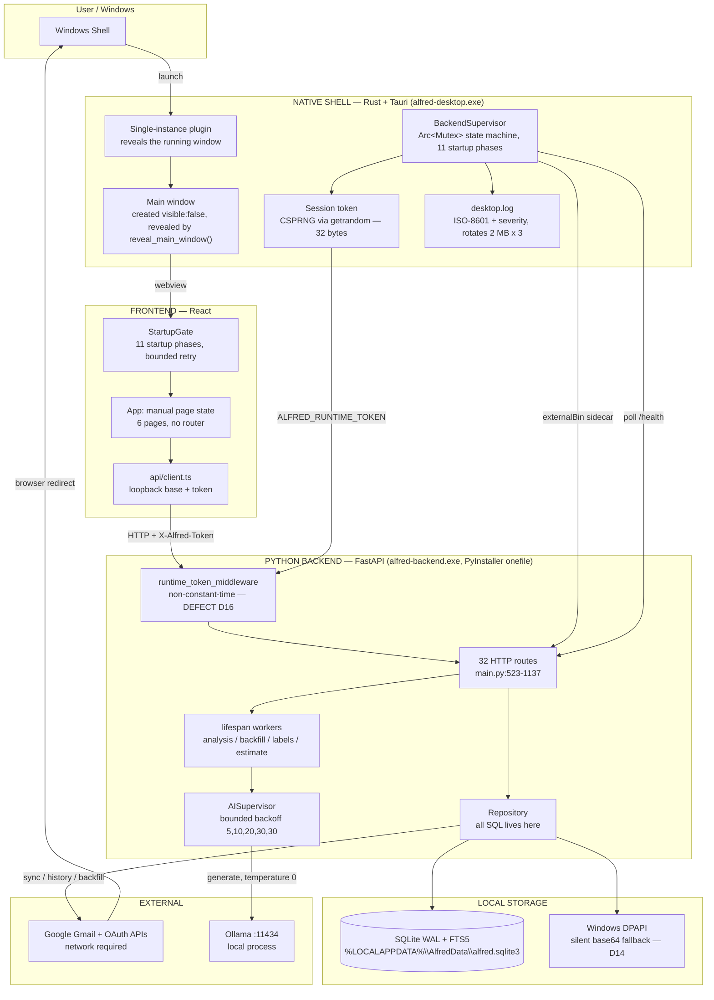

# Alfred — Architecture

Status: active
Baseline: Gate 0, 2026-09-26, HEAD `3cea34f`

This document describes the system **as it exists**, with defects marked inline.
Where the current design and the required design diverge, both are stated. This is
deliberately not an aspirational architecture document.

---

## 1. Four boundaries

Alfred is four distinct runtimes with a strict ownership rule: each owns its own
concerns and no other layer may reach across.

| Layer | Technology | Owns | Source |
| --- | --- | --- | --- |
| FRONTEND | React 19 + TypeScript + Vite 8 | Rendering, user interaction, local UI state | `frontend/` |
| NATIVE SHELL | Rust 1.90 + Tauri 2 | Process lifecycle, window, sidecar supervision, session token | `desktop/src-tauri/` |
| PYTHON BACKEND | Python 3.12 + FastAPI 0.115 | Gmail, SQLite, local AI orchestration, HTTP API | `backend/` |
| LOCAL AI RUNTIME | Ollama (external process) | Inference only | not vendored |

The rule: **the frontend never spawns a process, never reads a file, and never holds a
Gmail credential.** It talks to the backend over HTTP on loopback and to the shell over
Tauri IPC. The shell never interprets mail. The backend never touches the window.

## 2. Runtime diagram



## 3. Frontend architecture

React 19, no router. `frontend/src/App.tsx:32` holds `useState<AppPage>('mail')`; six
pages render conditionally. There is no URL, so there is no deep link, no back button,
and no page reload persistence. This is a deliberate simplification recorded in
`App.tsx:35-37` and preserved here; changing it is a Phase 3 decision, not a bug fix.

| Concern | Module | Notes |
| --- | --- | --- |
| Bootstrap | `src/main.tsx` | `initApi()` is called **before** `createRoot`, so backend resolution overlaps React startup |
| Readiness gate | `src/layout/StartupGate.tsx` | Renders the shell's 11-phase status (`starting` / `error` / `ready` UI states). Retry is **one attempt per click**, cancellable on unmount — never an automatic loop |
| Navigation | `src/layout/IconRail.tsx` | 4 primary + 2 secondary items, all reachable |
| Header / search | `src/layout/WorkspaceHeader.tsx` | `Ctrl+K` / `Cmd+K`, `Escape` to blur |
| HTTP | `src/api/client.ts` | Base URL + token are module-level mutable state set once by `initApi()` |
| Endpoint wrappers | `src/api/emails.ts` | 218 lines, typed |
| Server state | `@tanstack/react-query` | `staleTime` 10 s, `retry: 1` |
| Live progress | `src/components/ui/AnalysisProgress.tsx` | `EventSource` on `/api/analysis/progress` |
| Styling | `src/styles/*.css` | Hand-written semantic CSS, 7 files |
| Theming | `src/theme/` | `localStorage['alfred-theme']`, applied pre-paint by an inline script in `index.html` |

**Styling reality.** Tailwind v4 is installed and `@import "tailwindcss"` runs, so its
preflight is injected and then overridden by `src/styles/reset.css`. There are **zero
Tailwind utility classes** in the codebase; every `className` is a hand-written semantic
name backed by `src/styles/globals.css` (2 567 lines, 366 rule blocks). `components.json`
declares a shadcn setup but no shadcn component has ever been generated — `src/components/ui/`
contains only `AnalysisProgress.tsx`. This is a real inconsistency between configuration
and reality, resolved in Phase 3 (see ADR-004).

**Bundle.** One JS chunk, no route-level code splitting:

```
dist/assets/index-wPkchqex.js     375.83 kB   (113.98 kB gzip)
dist/assets/index-Dm8CLEoE.css     63.87 kB   ( 11.87 kB gzip)
dist/assets/core-CwxXejkd.js        0.09 kB
dist/assets/dist-js-BC4xjHHk.js    0.13 kB
dist/index.html                     1.16 kB
dist/*.map                                0   <- no source maps, correct
```

## 4. Backend architecture

One FastAPI app in one module. `backend/app/main.py` is 1 137 lines and holds every
route; `backend/app/api/` is an **empty directory**. The layering that exists is
`main.py` → `services` / `mail` / `ai` / `db`.

| Module | Lines | Owns |
| --- | --- | --- |
| `app/main.py` | 1 137 | All 32 routes, lifespan, middleware, exception handlers, SSE, workers |
| `app/config.py` | 82 | Env loading (hand-rolled dotenv, `setdefault` so process env wins) |
| `app/schemas.py` | 125 | Pydantic contracts, also used as the Ollama JSON schema |
| `app/db/database.py` | 789 | DDL, PRAGMAs, 6 idempotent migration steps, FTS5 lifecycle |
| `app/db/repositories.py` | 1 060 | All SQL |
| `app/db/secure_store.py` | 61 | DPAPI encrypt/decrypt |
| `app/ai/ollama_client.py` | 151 | HTTP to Ollama, 4 error types, no retries |
| `app/ai/service.py` | 237 | Prompts, body sanitisation, briefing synthesis |
| `app/ai/supervisor.py` | 304 | Availability detection, auto-start, backoff |
| `app/mail/providers/gmail.py` | 588 | OAuth, sync, backfill, HTML extraction |
| `app/mail/eligibility.py` | 294 | Label → state → category → scheduling policy |
| `app/services/task_derivation.py` | 274 | Analysis → tasks, fingerprint dedup, noise filtering |

### Route inventory

All routes are in `main.py`. Auth is the `runtime_token_middleware`, active only when
`ALFRED_RUNTIME_TOKEN` is set — which the shell always does in a packaged build.

| Method | Path | Line | Auth |
| --- | --- | --- | --- |
| POST | `/api/shutdown` | 573 | token |
| GET | `/health` | 621 | token |
| GET | `/api/config` | 639 | token |
| GET | `/api/accounts` | 649 | token |
| POST | `/api/accounts/gmail/connect` | 664 | token |
| GET | `/api/accounts/gmail/callback` | 694 | **exempt** (`main.py:551`) |
| DELETE | `/api/accounts/{id}` | 741 | token |
| POST | `/api/accounts/{id}/sync` | 751 | token |
| POST | `/api/accounts/{id}/backfill` | 813 | token |
| POST | `/api/accounts/{id}/backfill/pause` | 837 | token |
| GET | `/api/accounts/{id}/backfill` | 850 | token |
| GET | `/api/analysis/progress` (SSE) | 860 | token or `?token=` |
| GET | `/api/analysis/status` | 884 | token |
| POST | `/api/analysis/retry` | 895 | token |
| GET | `/api/emails/counts` | 918 | token |
| GET | `/api/emails` | 924 | token |
| POST | `/api/emails/search` | 954 | token |
| GET | `/api/emails/{id}` | 970 | token |
| POST | `/api/emails/import` | 978 | token |
| POST | `/api/emails/{id}/analyze` | 996 | token |
| POST | `/api/emails/analyze` | 1021 | token |
| POST | `/api/emails/{id}/draft` | 1039 | token |
| GET | `/api/briefing` | 1075 | token |
| POST | `/api/briefing/generate` | 1079 | token |
| GET | `/api/tasks` | 1092 | token |
| POST | `/api/tasks/{id}/toggle` | 1098 | token |
| DELETE | `/api/tasks/{id}` | 1107 | token |
| POST | `/api/tasks/{id}/dismiss` | 1115 | token |
| PATCH | `/api/tasks/{id}` | 1128 | token |

`/docs`, `/openapi.json` and `/redoc` are unauthenticated: the middleware only gates
paths starting with `/api/` plus `/health` (`main.py:563`).

**Error shape is inconsistent.** Four handlers return `{"error": {"code", "message",
"details"}}`; the rest raise `HTTPException` and return FastAPI's `{"detail": ...}`.
There is no catch-all handler. See `docs/Rules.md` §Error handling.

### Startup sequence (backend)

Executed at **import time**, not in `lifespan`:

1. `main.py:37` `get_settings()` — env + dotenv
2. `main.py:41` `Repository(...)` — opens SQLite, runs DDL, runs all 6 migrations
3. `main.py:42-45` construct `OllamaClient`, `AIService`, `AISupervisor`, `GmailProvider`
4. `main.py:47` `OAUTH_STATES = {}` — in-memory PKCE state, unbounded, no expiry
5. `main.py:523` `app = FastAPI(..., lifespan=lifespan)`
6. On lifespan entry (`main.py:493-506`): five background tasks are created
   (analysis worker, backfill worker, label backfill, backfill estimate, startup
   background) and control yields to the server immediately
7. `_startup_background` (`main.py:441`): `ai.preload()` → `ai_supervisor.refresh()` →
   broadcast state → `rebuild_tasks_from_analyses` → reset stuck jobs → rearm backfill
8. On shutdown: cancel all five tasks, `repo.close()`

Migrations run at step 2, before the socket is listening. A migration failure therefore
prevents the port from ever opening, which the shell surfaces as `health timeout`
rather than a migration error. See `docs/Memory.md` F25.

## 5. Native desktop architecture

One Rust file, 2 327 lines: `desktop/src-tauri/src/main.rs`.

| Item | Value |
| --- | --- |
| Binary | `alfred-desktop.exe` |
| Subsystem | `#![cfg_attr(not(debug_assertions), windows_subsystem = "windows")]` (`main.rs:1`) |
| Window | 1280x850, min 900x650, created `visible: false`, revealed by `reveal_main_window()` |
| Sidecar | `tauri_plugin_shell` `externalBin: binaries/alfred-backend` |
| Build id | `git rev-parse --short=12 HEAD` via `build.rs`, fallback `unknown`. `build.rs` declares `cargo:rerun-if-changed` for `.git/HEAD` **and** the ref it points at, so the stamp cannot go stale across a commit that touches nothing else |
| Capabilities | `core:default` + `opener:default` only. **No `shell:` grant** — the webview cannot spawn processes |
| CSP | `tauri.conf.json:25` — no development origin |
| Log | `%LOCALAPPDATA%\AlfredData\logs\desktop.log` |
| Commands exposed | `await_backend_ready`, `restart_backend`, `backend_info`, `startup_phase`, `startup_diagnostics` |

### Startup state machine

Eleven named phases, not three. `main.rs:82-112`:

```rust
pub enum StartupPhase {
    Boot, Initializing, StartingBackend, WaitingForBackend,
    CheckingDatabase, CheckingAiRuntime, CheckingModel, RestoringSession,
    Ready,        // terminal success
    Recovery,     // degraded but usable; the mailbox works
    FatalError,   // terminal failure; requires user action
}
```

Every phase serialises to a stable wire string, mirrored by `STARTUP_PHASES` in
`frontend/src/api/client.ts` and pinned by `startup_phases_serialise_as_documented`.
`READY` and `RECOVERY` both release the workspace; `FATAL_ERROR` never does
(`is_terminal_failure`, `main.rs:109`).

Each state carries a machine-readable code and a user-facing sentence:

```rust
pub struct StartupStatus {          // main.rs:267
    pub phase: StartupPhase,
    pub code: &'static str,         // e.g. "BACKEND_HEALTH_TIMEOUT"
    pub detail: String,
    pub guidance: String,           // safe sentence; empty while healthy
    pub ready: bool,
    pub degraded: bool,
    pub phase_elapsed_ms: u64,
}
```

`code` comes from the `DiagnosticCode` enum (`main.rs:136`) and each variant has a
matching `guidance()` (`main.rs:188`). The codes are stable strings —
`SIDECAR_EXITED`, `BACKEND_HEALTH_TIMEOUT`, `DATABASE_UNAVAILABLE` and so on — and
`startup.phase` is logged with the field name `diag=`, never `code=`, because the
global redaction filter treats a bare `code=` as an OAuth authorization code.

The shell is authoritative about *why* startup failed. `StartupGate` renders the
shell's `status.code` / `status.guidance` whenever `status.phase === 'FATAL_ERROR'`,
falling back to the frontend promise's own watchdog only when no terminal snapshot
arrived. The two are deliberately offset: `STARTUP_TIMEOUT = HEALTH_TIMEOUT + 15 s`, so
the poller's specific verdict always wins the race.

**Historical (Gate 0 baseline, superseded by Phase 1).** This section previously
described a three-state `BackendRuntimeState { Starting, Ready, Failed { reason: String } }`
whose `Failed` reasons were raw English prose (`"health timeout"`, `"startup timeout"`,
`"sidecar exited with code {:?}"`) rendered by `StartupGate` under the label
"Diagnostic code", which it was not. That machine is gone.

### Startup sequence (shell)

1. `main()` calls `init_logging()`, then logs version, build, pid, exe, cwd
2. Plugins registered: shell, opener, single-instance. The single-instance callback
   calls `reveal_main_window(app)` — a second launch surfaces the running window, and
   is deliberately never the only thing that can reveal it
3. `setup()` builds the `ShutdownRegistry` and the supervisor, then calls
   `reveal_main_window()` immediately so the branded shell is on screen while the
   backend boots; the run loop's `RunEvent::Ready` reveals again (idempotent)
4. `spawn_and_watch`: `pick_free_port()` (bind :0, read port, close) →
   `kill_orphaned_backends()` → `generate_token()` (CSPRNG, 32 bytes) → sidecar spawn
   with `ALFRED_HOST/PORT/BACKEND_BUILD/RUNTIME_TOKEN` → drain stdout/stderr → poll
   `/health` every 500 ms for 60 s
5. The frontend loads in parallel and blocks on `await_backend_ready` in `StartupGate`
6. **`window.show()` is called** — always, through the single reveal point
   `reveal_main_window()` (`main.rs:1367`): `window.show()` then `set_focus()`, logged as
   `window.revealed reason=explicit`. Its callers are `setup()`, `RunEvent::Ready`, the
   single-instance callback, and the readiness command

### Backend crash while running

The shell supervises the sidecar for the whole session, not only during startup.
`CommandEvent::Terminated` (`main.rs:521`) logs
`sidecar.exited pid=… exit=Some(…) generation=…`, and — only if the dying process is
still the current generation — publishes `StartupPhase::FatalError` with
`DiagnosticCode::SidecarExited`, logs the lifecycle line
`startup.phase phase=FATAL_ERROR diag=SIDECAR_EXITED`, and emits
`alfred://startup-phase`.

`StartupGate` watches for exactly that while `state === 'ready'` and reuses the same
failure surface, titling it "Alfred's local service stopped" so it does not claim
Alfred failed to start. It deliberately says nothing about Gmail: a dead backend is not
a disconnected account.

### Timing

```
HEALTH_TIMEOUT   60 s    main.rs:36
HEALTH_INTERVAL  500 ms  main.rs:37
STARTUP_TIMEOUT  75 s    main.rs:47   = HEALTH_TIMEOUT + 15 s
SHUTDOWN_GRACE   600 ms  main.rs:51
LOG_MAX_BYTES    2 MB    main.rs:55   (3 rotated files)
```

`STARTUP_TIMEOUT` is deliberately `HEALTH_TIMEOUT + 15 s`. When both were 60 s the
frontend's generic `STARTUP_TIMEOUT` won the race against the poller and the user was
told the wrong thing; the outer watchdog now always loses.

### Process supervision

| Requirement | Implementation | State |
| --- | --- | --- |
| Single backend instance | single-instance plugin + `kill_orphaned_backends` | works |
| Predictable port | bind-to-0 then release | **known race** — the port is not reserved for the child. Not in Gate 1 scope |
| Health endpoint | `GET /health` polled; `probe_health` parses the status, the `application/json` content type and the payload | works |
| Startup watchdog | 60 s health poll; 75 s outer frontend watchdog | works; the poller's specific code wins |
| Graceful shutdown | `ShutdownRegistry::terminate()`: `POST /api/shutdown`, 600 ms, then hard kill | works — blocking, **not** `try_lock` |
| Crash detection | `CommandEvent::Terminated` → `FatalError` / `SidecarExited`, published and logged | works, including after `READY` |
| Restart | `restart_backend` → `stop_child()` then `spawn_and_watch()` | works while `Starting`; generation-guarded, a stale poller cannot clobber a new child |
| Structured logs | ISO-8601 with milliseconds, level, target; one `write_all` per record under a process-wide lock | severity and rotation present; **no correlation id** — `generation=` is lifecycle-only |
| Diagnostic codes | `DiagnosticCode` + `guidance()`, stable wire strings | works; pinned by `diagnostic_codes_are_stable_strings` and `every_diagnostic_code_has_distinct_guidance` |
| No orphan processes | ownership released only by `stop_child()` and `terminate()` | works; verified on the clean **and** the terminal-failure path |
| No console window | `windows_subsystem = "windows"` | works in release builds |

`kill_orphaned_backends` (`main.rs:1046`) shells out to `netstat`, `tasklist`, and
`taskkill` by bare name, and kills any loopback listener whose image name contains
`alfred-backend`. It is crude but it does prevent the common orphan case.

## 6. IPC and API boundaries

| Edge | Mechanism | Authentication |
| --- | --- | --- |
| Webview → shell | Tauri IPC, 3 commands | Tauri capability allowlist; no `shell:` grant |
| Webview → backend | HTTP on `127.0.0.1:<dynamic>` | `X-Alfred-Token` header, or `?token=` for SSE |
| Backend → Google | HTTPS | OAuth bearer token |
| Backend → Ollama | HTTP on `127.0.0.1:11434` | none (loopback) |
| Shell → sidecar | env vars at spawn | loopback bind only |

The port is discovered by the frontend only through `await_backend_ready`. There is no
port file, no fixed port, and no discovery service. This is a sound design; the
implementation of the token that guards it is the problem (D3, D16).

## 7. Gmail OAuth

- Authorization endpoint `https://accounts.google.com/o/oauth2/v2/auth`
  (`gmail.py:14`), token endpoint `https://oauth2.googleapis.com/token`
- PKCE S256; verifier `secrets.token_urlsafe(64)` (`main.py:345-349`), state
  `uuid4().hex` stored in the module-global `OAUTH_STATES` and popped on callback
- `access_type=offline`, `prompt="select_account consent"`
- Scopes: `userinfo.email`, `gmail.readonly` — read-only, no send, no modify
- `client_secret` is sent only when non-empty, which is correct for Google
  installed-app clients
- Callback is exempt from token auth (`main.py:551`) because the browser hits it
- Tokens are DPAPI-encrypted before storage and re-encrypted on every refresh
  (`main.py:723-734`)

Defects: the query string is assembled with `httpx.URL(v)` per value, which does not
percent-encode (`gmail.py:40`); `OAUTH_STATES` never expires; consent opens in an
in-app popup rather than the system browser.

## 8. Gmail synchronization

Three distinct mechanisms, deliberately separated:

| Mechanism | Query | Trigger | Notes |
| --- | --- | --- | --- |
| Initial sync | `label:INBOX` | `POST /api/accounts/{id}/sync` | `/profile` for `historyId`, then 50/page |
| Incremental | `/history?startHistoryId=` | same endpoint | 100/page; `400/404/410` or any error falls back to a full sync |
| Backfill | `-label:INBOX` | background worker | 40/page, 2.5 s between pages, durable cursor |

Spam arriving through history is never cached (`gmail.py:444`). Label-only changes are
refreshed with `format=METADATA` so bodies are not re-transferred. Permanent deletion
is recorded as `mailbox_state='trash'`, `pipeline_eligibility='excluded'` rather than
destroying the row, which preserves user corrections.

## 9. Database

SQLite in WAL mode, one file, no ORM.

```
PRAGMA journal_mode=WAL          synchronous=NORMAL
PRAGMA busy_timeout=5000         foreign_keys=ON
PRAGMA cache_size=-8000          -- 8 MB
```

Eight tables: `emails`, `email_analysis`, `inbox_briefing`, `accounts`, `credentials`,
`tasks`, `jobs`, `inference_metrics`. Twelve indexes plus a partial unique index on
`(account_id, provider_message_id)`.

FTS5 uses a contentless-delete virtual table with an explicit capability probe
(`fts_delete_supported`, `database.py:192-219`) because `contentless_delete` requires
SQLite >= 3.43. The probe result is cached per connection. If the unique index cannot be
created because legacy duplicates exist, the failure is logged and the invariant is
silently lost (`database.py:327-330`).

**There is no schema version table.** Migration is six idempotent, inspect-then-act
steps that each commit separately, re-derivable on every start. The two destructive
steps (scoped-ID re-key, thread backfill) take a WAL-safe `sqlite_backup` first and
raise `MigrationSafetyError` if the backup cannot be taken — fail-closed, which is the
right call. Versioning information exists only in `tasks.derivation_version`,
`email_analysis.schema_version` and `inbox_briefing.schema_version`.

## 10. AI service and Ollama

- `OllamaClient` wraps `POST /api/generate` with `stream=false`, `think=false`,
  `keep_alive="30m"`, `temperature=0.0` for analysis, and the Pydantic
  `model_json_schema()` as `format`
- Four error types map to HTTP status codes: `OllamaUnavailable` 503,
  `OllamaTimeout` 504, `OllamaInvalidResponse` 502, `OllamaModelMissing` 503
- Leaked `<think>` blocks are stripped from responses (`ollama_client.py:118-121`)
- `AIService` sanitises the body before inference: drops quoted lines, cuts at the
  signature, replaces long base64 runs, rewrites long URLs, removes tracking pixels,
  truncates to 2 000 characters
- Cache key is SHA-256 of sender + normalised subject + normalised body +
  `received_at` (`mail/fingerprint.py:4-6`)
- `AISupervisor` detects availability, attempts one auto-start of a found
  `ollama.exe`, and applies a bounded backoff of `(5, 10, 20, 30, 30)` seconds. Its
  smoke test uses fixed synthetic text, never user content
- There is **no retry inside the client**; retries exist only at the job-queue layer

`prompt` is truncated per-message, and the briefing synthesis overwrites model-supplied
counts with locally computed counts (`service.py:231-237`) and replaces a degenerate
executive summary with a locally generated one. This distrust of model output for
anything countable is deliberate and correct.

## 11. Model lifecycle

Today the model is a build-time constant (`OLLAMA_MODEL`, default `qwen3:4b`) and
Ollama is an unmanaged external prerequisite. There is no model list, no pull, no
progress, no size reporting, no disk-space check, and no cancel. This is the largest
product gap. Required states are in `docs/PRD.md` §10 and implemented in Phase 2.

## 12. Configuration

Ten environment variables, all read in `backend/app/config.py`:

| Variable | Default | Notes |
| --- | --- | --- |
| `OLLAMA_BASE_URL` | `http://127.0.0.1:11434` | |
| `OLLAMA_MODEL` | `qwen3:4b` | should become user-configurable |
| `ALFRED_HOST` | `127.0.0.1` | read but **never used** |
| `ALFRED_PORT` | `8765` | used only by `sidecar.py`, which hardcodes the host |
| `ALFRED_DATABASE_PATH` | derived | |
| `GMAIL_CLIENT_ID` | `PLACEHOLDER_CLIENT_ID` | required for Gmail |
| `GMAIL_CLIENT_SECRET` | `""` | **shipped inside the binary**, D13 |
| `ALFRED_BACKEND_BUILD` | `None` | injected by the shell; missing from `.env.example` |
| `ALFRED_RUNTIME_TOKEN` | `None` | injected by the shell; missing from `.env.example` |
| `LOCALAPPDATA` | `.` | data root |

Loading order: a hand-rolled dotenv parser uses `os.environ.setdefault`, so **real
process environment always beats the file**. In a frozen build it looks for
`production.env` in `_MEIPASS`, the exe directory, and `exe_dir/resources`; otherwise it
reads `backend/.env`. `.env.example` documents the deprecated
`%LOCALAPPDATA%\Alfred\` database path rather than the current `%LOCALAPPDATA%\AlfredData\`.

## 13. Filesystem layout

```
%LOCALAPPDATA%\AlfredData\
  alfred.sqlite3            database (WAL: -wal, -shm)
  logs\
    desktop.log             shell, ISO-8601 + severity, rotates 2 MB x 3
    desktop.log.1..3        rotated shell log
    backend.log             sidecar, rotating 1 MB x 2

%LOCALAPPDATA%\Alfred\     legacy location, still read by _default_database_path()

%LOCALAPPDATA%\Programs\Ollama\ollama.exe   probed for auto-start

%LOCALAPPDATA%\Alfred\      install dir (per-user NSIS)
  alfred-desktop.exe
  alfred-backend.exe
```

## 14. Logging

| Stream | Format | Rotation | Secrets |
| --- | --- | --- | --- |
| `desktop.log` | `{iso8601_ms} {level} {target} {redacted message}` — one `write_all` of a finished record under a process-wide `LOG_LOCK` | **yes**: 2 MB x 3 (`rotate_if_needed`, `main.rs:810`) | none — the token, the OAuth `code=` and JSON-shaped secrets are stripped by `redact()` before anything is written |
| `backend.log` | stdlib logging, rotating | 1 MB x 2 | none |
| `alfred.fts`, `alfred.search` | Python loggers | inherits | none |

Gaps against the required structure (timestamp, subsystem, event, diagnostic code,
severity, correlation id): severity, timestamp, rotation and diagnostic codes are now
present on the shell side; **no correlation id** and **no subsystem field** remain, and
every write failure is still discarded with `let _ =`. Lifecycle lines carry
`generation=`, which correlates a record to a supervision generation but is not a
request-scoped correlation id. Nothing logs message bodies, tokens, or credentials —
that constraint is currently met.

## 15. Error handling

Three layers are required: user-facing message, diagnostic context, structured log.
Today only the first exists, and only sometimes.

- Four Ollama exceptions map to clean status codes
- `MigrationSafetyError` is fail-closed
- Everything else surfaces as a raw exception string, which `StartupGate` then labels
  "Diagnostic code"
- **Shell/startup (corrected by Phase 1).** The shell no longer sends prose to the
  gate. It publishes a `StartupStatus` carrying a stable `DiagnosticCode` wire string
  and a `guidance()` sentence, and `StartupGate` renders those. The frontend's own
  promise error is used only as a fallback when no terminal snapshot arrived, and a
  raw exception is never the primary message
- Frontend error extraction (`client.ts:57-60`) tries `body.error.message`, then
  `body.detail`, then a literal fallback

## 16. Installer

NSIS only, per-user (`installMode: currentUser`), `externalBin` sidecar resolved to
`alfred-backend-x86_64-pc-windows-msvc.exe` and installed as `alfred-backend.exe`.
Start Menu shortcut is created by Tauri; the NSIS finish-page checkbox creates a
desktop shortcut. Upgrade detection compares `DisplayVersion`.

Verified present in the tree: `target/release/alfred-desktop.exe` (11.8 MB),
`alfred-backend.exe` (39.4 MB), `Alfred_0.1.0_x64-setup.exe` (41.9 MB), and
`release-manifest.json` with SHA-256 for each.

Configuration gaps: no `publisher` (the generated installer says `MANUFACTURER
"alfred"`), empty `HOMEPAGE`, `LICENSE`, `COPYRIGHT`, `INSTALLERICON`; no signing;
`ALLOWDOWNGRADES true`; `INSTALLWEBVIEW2MODE downloadBootstrapper` means the installer
requires network access at install time. MSI is not configured.

## 17. Updater

Does not exist. No `createUpdaterArtifacts`, no pubkey, no update check. Non-goal for
this release cycle; the installer ships an upgrade path via NSIS version comparison.

## 18. Public website

Does not exist. Verified: zero matches for any site framework config, zero site
directories, zero tracked `.yml`/`.yaml`, and the only frontend is the application
itself. This is Phase 6 work.

## 19. Analytics boundary

Alfred contains no analytics. This is a hard architectural boundary, not a policy: the
product's privacy claim is only credible because there is no code path that could
exfiltrate mail. Any future telemetry requires a new ADR and a visible change to the
privacy page. Google Analytics, if it is ever added, belongs to the website only and
must never share a bundle, a request, or a cookie with the application.

## 20. Security boundaries

| Boundary | Control | State |
| --- | --- | --- |
| Webview → native | Tauri capabilities; no `shell:` grant | **correct and well configured** |
| Webview → backend | per-launch runtime token | token source weak (D3), comparison not constant-time (D16) |
| Backend → Gmail | DPAPI at rest | silently degrades to base64 (D14) |
| Backend → Google | `gmail.readonly` only | **correct, no write scope** |
| Backend → Ollama | loopback, no auth | acceptable; requires local trust |
| Webview → external URLs | `opener:default` restricted to http/https/mailto/tel | **correct**, validated again in `lib/urlSecurity.ts` |
| OAuth popup → app | `postMessage` | **origin not checked** (D17) |
| Webview → CSP | `tauri.conf.json:25` | dev origin permitted in production (D12) |
| Sidecar → disk | PyInstaller extraction dir | contains the OAuth secret (D13) |

Genuinely good decisions already in place, which must be preserved: least-privilege
capabilities with no `shell:` grant, read-only Gmail scope, `urlSecurity.ts` protocol
allow-listing, DPAPI at rest, prompt-injection defence in the analysis prompt, and HTML
sanitisation on both ingest and display.

## 21. Dependency ownership

| Dependency group | Owner | Note |
| --- | --- | --- |
| Python | `backend/requirements.txt` | 7 entries: fastapi, uvicorn, pydantic, httpx, python-multipart, pytest, pyinstaller |
| Python dev extras | `backend/build_sidecar.py` | needs `python-dotenv`, **not in requirements** |
| Frontend | `frontend/package.json` | 16 runtime + 12 dev, several unused (D25) |
| Rust | `desktop/src-tauri/Cargo.lock` | tauri 2, shell, opener, single-instance, tokio, serde, log |
| CI | **none** | no `.github/`, zero workflow files |

There is no dependency duplication and no second icon library. The unused-dependency
list in `docs/Memory.md` is the only cleanup debt here.

## 22. ADRs

Decisions live in `docs/decisions/`. The pre-existing Obsidian ADRs
(`docs/obsidian/14 - Decisions/`, 19 notes) are retained as history. Where an Obsidian
ADR contradicts the code, **the code wins and the ADR is corrected** — several currently
do, notably ADR-015's claim of a high-entropy runtime token and ADR-016's claim that the
window is revealed on readiness.
